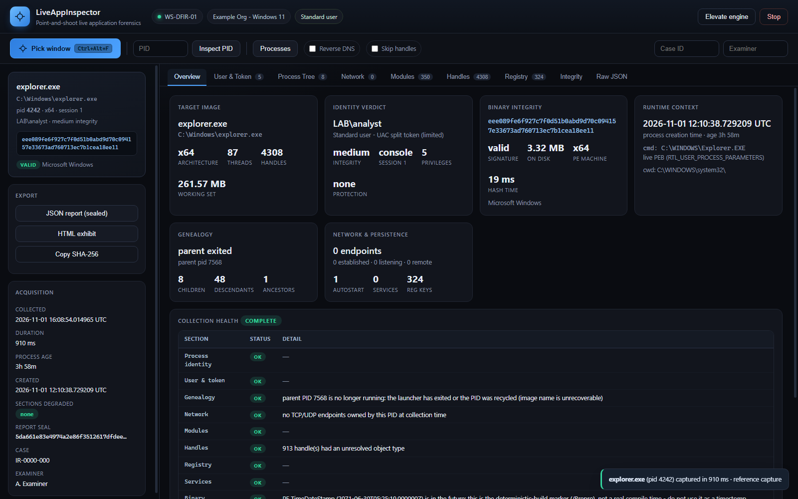
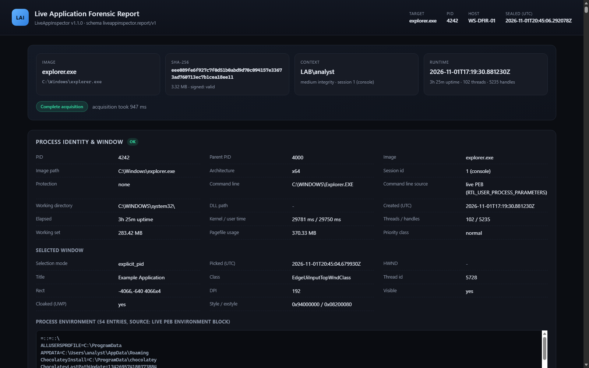
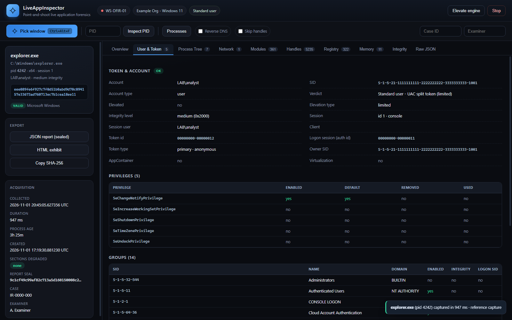
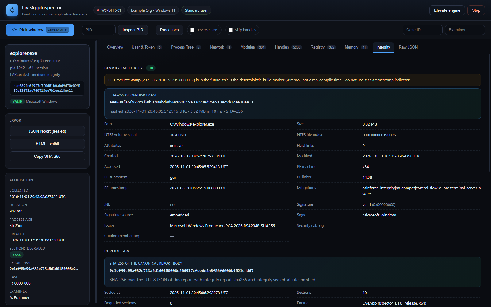

# LiveAppInspector

[](https://github.com/horizonbymuneeb/liveappinspector/actions/workflows/ci.yml)
[](https://github.com/horizonbymuneeb/liveappinspector/releases/latest)
[](https://github.com/horizonbymuneeb/liveappinspector/releases)
[](LICENSE)
[](#)
[](https://github.com/horizonbymuneeb/liveappinspector/blob/main/engine/Cargo.toml)

**Point-and-shoot live application forensics for Windows.** Press a hotkey, click
a window, get a sealed forensic report about the process behind it.

LiveAppInspector is a DFIR triage tool: press the hotkey, click any window on the
desktop, and get a complete, timestamped, cryptographically sealed report about
the process behind it — identity, token, ancestry, sockets, loaded modules, open
handles, registry/persistence artifacts, and the on-disk image's SHA-256.

```
┌──────────────────────────────────────────────────────────────────────────┐
│  LAI  LiveAppInspector            alian · ALIAN\tmune     [Administrator] │
│       point-and-shoot DFIR                                               │
├──────────────────────────────────────────────────────────────────────────┤
│  [ ⊕ Pick window  Ctrl+Alt+F ]  PID [ 7616 ] [Inspect]  [Processes]       │
├───────────────┬──────────────────────────────────────────────────────────┤
│ explorer.exe  │ Overview  User&Token  Tree  Network  Modules  Handles ... │
│ C:\Windows\…  │                                                          │
│ pid 7616 x64  │   explorer.exe            ALIAN\tmune    2baa43fa…c45290  │
│ SHA-256       │   x64 · 90 threads        medium · console  Microsoft Win│
│ eee089fe…ee11 │                                                          │
└───────────────┴──────────────────────────────────────────────────────────┘
```

---

## Install

Windows 10/11 x64. Single self-contained `lai.exe` (~1.4 MB) — no runtime, no
installer, no dependencies, and no MSVC required to build.

```powershell
# download, verify the published SHA-256, install to %LOCALAPPDATA%
iwr https://raw.githubusercontent.com/horizonbymuneeb/liveappinspector/main/scripts/install.ps1 | iex
```

Or pick a channel:

| Channel | How |
|---|---|
| **Portable zip** | [latest release](https://github.com/horizonbymuneeb/liveappinspector/releases/latest) → `lai-<version>-win64.zip` (binary, launchers, docs, tests) |
| **Standalone exe** | download `lai.exe` + `SHA256SUMS.txt`, verify, run |
| **Scoop** | manifest is generated per release (`dist/packaging/scoop/`); see [RELEASING.md](docs/RELEASING.md) |
| **winget** | manifests are generated per release (`dist/packaging/winget/`); submit via `wingetcreate` |
| **From source** | `git clone … && .\build.ps1` |

Verify before you run it — this tool reads your machine, so trust nothing unverified:

```powershell
(Get-FileHash .\lai.exe -Algorithm SHA256).Hash.ToLower()   # compare with SHA256SUMS.txt
.\lai.exe --version
.\lai.exe self-check
```

> Signed builds are strongly recommended for managed fleets: unsigned binaries are
> blocked by Smart App Control / WDAC / AppLocker. See [docs/DEPLOYMENT.md](docs/DEPLOYMENT.md).

---

## Documentation

Full index: [docs/README.md](docs/README.md). Every relative link and heading
anchor is checked in CI ([scripts/check-docs.py](https://github.com/horizonbymuneeb/liveappinspector/blob/main/scripts/check-docs.py)), so the
map below cannot rot.

| Document | What it answers |
|---|---|
| [docs/FAQ.md](docs/FAQ.md) | "Windows blocked it", "why is this `denied`", `type_56` handles, hash mismatch, catalog vs embedded signing, AV quarantine |
| [docs/FORENSIC_NOTES.md](docs/FORENSIC_NOTES.md) | per-field provenance, caveats, false-positive guidance for every artifact |
| [docs/CHAIN_OF_CUSTODY.md](docs/CHAIN_OF_CUSTODY.md) | seal algorithm, manual verification recipe, what the seal does and does not prove |
| [docs/SCHEMA.md](docs/SCHEMA.md) + [schema/report-v1.schema.json](schema/report-v1.schema.json) | the machine contract, `status` semantics, versioning policy, `jq` recipes |
| [docs/DEPLOYMENT.md](docs/DEPLOYMENT.md) | one-click usage, SAC/WDAC/AppLocker blocks, elevation, acceptance tests |
| [ARCHITECTURE.md](ARCHITECTURE.md) | data flow, module map, threading model, failure philosophy, extension points |
| [CONTRIBUTING.md](CONTRIBUTING.md) · [SECURITY.md](SECURITY.md) · [docs/RELEASING.md](docs/RELEASING.md) | how to change it, how to report a flaw, how a release is cut |
| [CHANGELOG.md](CHANGELOG.md) | what changed, including every bug the test suite caught before 1.0.0 |

## 0. The UI

The dashboard is `ui/index.html` + `ui/app.js` + `ui/style.css`, embedded into the
binary at compile time and served over loopback. Reference captures from a live
acquisition of `explorer.exe` (standard user, ~1.2 s):

| Dashboard - overview | Court-facing HTML exhibit |
|---|---|
|  |  |

| User & Token (Module B) | Integrity, signature & seal (Module F) |
|---|---|
|  |  |

Tabs: **Overview · User & Token · Process Tree · Network · Modules · Handles ·
Registry · Integrity · Raw JSON**, with a live sidebar (target card, SHA-256,
signature verdict, export buttons, acquisition metadata) and a toast for every
action.

---

## 1. What it collects

Every artifact is tied to one process and stamped with a high-precision UTC time.
Each section carries its own `status` (`ok` / `partial` / `denied` / `error` /
`skipped` / `timeout`) plus any Win32 error, so a partially-privileged run
produces a *defensible partial report* instead of a crash or a blank page.

| Module | Deliverable requirement | What is actually recorded | Implementation |
|---|---|---|---|
| **A** — Window & process identification | `GetCursorPos` → `WindowFromPoint` → `GetWindowThreadProcessId`, image path, arch | HWND, window title, class, DPI, rect, style bits, DWM-cloaked flag, PID, TID, image path, image name, x86/x64/ARM64, WOW64 status | `win/window.rs`, `win/process.rs` |
| **B** — User & session context | `OpenProcessToken` + `GetTokenInformation` | Account name/domain/SID, SID type, integrity level (+RID), elevation & elevation type, session id, session kind (console/RDP/service), session user, client name/IP, token id, logon session LUID, every privilege with its attributes, every group, AppContainer flag, virtualization flag | `win/token.rs`, `win/sys.rs` |
| **C** — Process tree & genealogy | `CreateToolhelp32Snapshot` / WMI | Kernel-verified parent (`NtQueryInformationProcess`), full ancestor chain, children, breadth-first descendants (depth ≤ 8), creation/exit times, **PPID-recycling detector**, live command line + cwd + environment read straight from the PEB (CIM marked as fallback) | `win/tree.rs`, `win/process.rs`, `win/kernel.rs` |
| **D** — Network connections | `GetExtendedTcpTable` / `GetExtendedUdpTable` | Every TCP/UDP endpoint owned by the PID, IPv4 + IPv6, state, local/remote address and port, optional bounded reverse DNS | `win/net.rs` |
| **E** — Handles, modules, registry | `EnumProcessModulesEx`, handle table | Full module list with version resources + base/size + *missing-on-disk* detection; system-wide handle table filtered to the PID with object type/name resolution (files → DOS paths, keys → `HKLM\…`), `Process`-type handles resolved to target PIDs; registry keys held open; autostart (`Run`/`RunOnce`/`RunServices`/`Winlogon`) entries referencing the image; SCM service registrations | `win/handles.rs`, `win/modules.rs`, `win/sys.rs` |
| **F** — Integrity & chain of custody | SHA-256 + UTC timestamps | Streamed SHA-256 with a second independent read pass (tamper-during-collection detector), NTFS volume serial + file index, timestamps, attributes, hard links, PE header facts, Authenticode **and** security-catalog trust, per-section timestamps, and an ordered custody log sealed with a report SHA-256 | `win/binary.rs`, `win/catalog.rs`, `report/json.rs` |

Extras that fall out of the design:

* **Kernel-table fallback** — when `OpenProcess` is refused (PPL/EDR/SYSTEM), the
  image name, start time, parent and thread count still come from
  `NtQuerySystemInformation(SystemProcessInformation)`, so the *on-disk binary can
  still be hashed and trust-checked*. Provenance is labelled in the report.
* **Denied ≠ empty** — every section explains what was denied and why, with the
  exact Win32 code and the remediation (elevate the engine).
* **Tamper-evident export** — `lai verify <report.json>` re-computes the seal.

---

## 2. Quick start

### Build

Requires a Rust toolchain (1.75+). No MSVC is needed: the recommended toolchain
is `stable-x86_64-pc-windows-gnu`, and the engine loads `dwmapi`, `wtsapi32`,
`wintrust` and `version` at runtime, so it builds on any MinGW sysroot.

```powershell
# one-time toolchain install (if you do not have rustc yet)
winget install Rustlang.Rustup
rustup default stable-x86_64-pc-windows-gnu

# build + stage the binary
.\build.ps1               # -> dist\lai.exe  (release, LTO, stripped)
# or manually
cd engine; cargo build --release; cargo test
```

### Run the dashboard

**No build step for the operator:** double-click `dist\Start LiveAppInspector.cmd`
(browser opens by itself), or `Start LiveAppInspector (Administrator).cmd` for
SYSTEM/protected targets. From a shell:

```powershell
dist\lai.exe serve --open          # binds 127.0.0.1:<ephemeral>, opens the browser
dist\lai.exe serve --port 8787     # fixed port
```

Then press **Ctrl+Alt+F** (or the crosshair button) and click any window.
The global hotkey works while the dashboard is in the background; the page picks
the result up automatically. Elevation is offered in-app (**Elevate engine**).

### Run headless

```powershell
# inspect a specific PID, write both exhibits
lai inspect --pid 7616 --json case42.json --html case42.html `
            --case IR-2026-001 --examiner "A. Examiner" --org "ACME DFIR"

# interactive pick, then full report on stdout
lai inspect --window --json case42.json

# verify an exhibit later (attacker or mishap cannot silently edit it)
lai verify case42.json
# => VERDICT: MATCH - report is intact

# utilities
lai hash "C:\Windows\System32\winlogon.exe" --json
lai procs --limit 40
lai self-check
```

Exit codes: `0` ok · `1` usage · `2` collection failed · `3` access denied
(so `lai inspect --pid 4; if ($LASTEXITCODE -eq 3) { "run elevated" }` works in
automation).

---

## 3. Project layout

```
LiveAppInspector/
├── build.ps1                  # release build + dist\ staging
├── README.md                  # this file
├── ARCHITECTURE.md            # design, threading, data flow, extension points
├── docs/
│   ├── CHAIN_OF_CUSTODY.md    # sealing algorithm + manual verification recipe
│   └── FORENSIC_NOTES.md      # per-artifact provenance, caveats, false positives
├── samples/README.md          # how to generate reference exhibits
├── ui/                        # dashboard (embedded into the binary at compile time)
│   ├── index.html
│   ├── app.js
│   └── style.css
└── engine/
    ├── Cargo.toml
    └── src/
        ├── main.rs            # CLI (inspect / pick / serve / hash / verify / procs)
        ├── engine.rs          # orchestrator: one collector per module, panic-isolated
        ├── model.rs           # the forensic schema (the report contract)
        ├── util.rs            # UTF-16, Win32 errors, FILETIME→RFC3339, escaping
        ├── server.rs          # loopback HTTP bridge + token gate
        ├── report/
        │   ├── json.rs        # canonical JSON + SHA-256 seal + verification
        │   └── html.rs        # self-contained dark HTML exhibit
        └── win/
            ├── ffi.rs         # every Win32/NT prototype and struct (auditable)
            ├── window.rs      # Module A: crosshair picker, global hotkey, window facts
            ├── process.rs     # handle RAII, image path, arch, times, PEB reader
            ├── token.rs       # Module B: token/SID/integrity/elevation/privileges
            ├── kernel.rs      # kernel process table (works when OpenProcess is denied)
            ├── tree.rs        # Module C: genealogy
            ├── net.rs         # Module D: owner-PID socket tables
            ├── modules.rs     # Module E: loaded modules + version resources
            ├── handles.rs     # Module E: handle table + object name resolution
            ├── sys.rs         # host/OS/session/services/autostart/elevation
            ├── binary.rs      # Module F: hash, NTFS identity, PE parse, trust
            ├── catalog.rs     # security-catalog (.cat) member verification
            └── paths.rs       # NT path → DOS path translation (verified to exist)
```

**Why a sidecar engine and an embedded web dashboard?** The collection path needs
direct Win32/NT access (hence Rust), while the UI benefits from a modern layout
engine. The engine serves the dashboard itself over loopback, so there is no
electron/node runtime, no native/webview ABI to maintain, and the exported HTML
exhibit is the same renderer logic an examiner already reviewed. The dashboard is
also the *only* client that holds the per-run session token.

---

## 4. Security model

* **Loopback only.** `TcpListener::bind(("127.0.0.1", port))` — never `0.0.0.0`.
* **Session token.** A per-run 128-bit token (SHA-256 of runtime entropy) is
  injected into the served HTML; every `/api/*` call must present it in
  `X-LAI-Token` (or `?t=` for downloads). An unauthenticated local process gets
  `401`.
* **No filesystem server.** Assets are `include_str!`-embedded; paths are matched
  exactly, so there is no path-traversal surface.
* **Body cap + header cap** on every request (4 MiB / 64 KiB).
* **Read-only collection.** No process memory is written, no registry value is
  modified, no service is touched. Files are opened `FILE_SHARE_READ|WRITE|DELETE`
  with `GENERIC_READ` only. The tool does not inject, suspend, or terminate.
* **No network egress** from the engine (reverse DNS is opt-in and bounded).
* **Exhibit hygiene.** The HTML report contains no `<script>`, no remote
  references and no external fonts, and every collected value is HTML-escaped
  (process/window/registry strings are attacker-controlled).

---

## 5. Performance (measured on the reference host)

| Target | Handles | Modules | Wall clock |
|---|---|---|---|
| `explorer.exe` (user, 90 threads) | 4 212 | 348 | **~0.9 s** |
| `OpenWith.exe` (user) | 916 | 133 | ~0.3 s |
| `winlogon.exe` (SYSTEM, handle denied) | 0 | 0 | ~0.6 s (hash + trust still collected) |

Costs are dominated by handle-name resolution (bounded by a 150 ms watchdog per
object) and hashing. `--no-handles` drops the typical acquisition to ~120 ms when
speed matters more than breadth.

---

## 6. Known limitations (read before testifying)

* **Protected processes.** PPL/PP/PPL-WinTcb targets (some AV/EDR, `MsMpEng`,
  LSA) refuse handle access even to Administrators. The report says `denied`,
  names the protection signer, and still supplies kernel-table facts + the
  on-disk hash.
* **Handle names.** `NtQueryObject` blocks on named pipes; those are identified
  and skipped by design. Objects whose type cannot be duplicated out of the
  process report a `type_N` placeholder (resolvable when the engine is elevated).
* **Object addresses.** Windows 11 redacts kernel object pointers from
  unprivileged callers; `object_address` is therefore usually empty by design.
* **CIM fallback.** If the PEB is unreadable, the command line comes from
  `Win32_Process` and is explicitly labelled as a weaker source.
* **PE timestamps.** Microsoft binaries use deterministic (`/Brepro`) stamps that
  can read as "compiled in the future"; the report calls this out instead of
  flagging timestomping.
* **Live acquisition is not an image.** This is volatile, point-in-time evidence;
  pair it with a disk image for court work. See `docs/FORENSIC_NOTES.md`.

### Deploying on hardened hosts (SAC / WDAC / AppLocker)

An **unsigned** build is blocked on hosts where Smart App Control, WDAC or
AppLocker enforce code integrity (`error 4551 / ERROR_VIRUS_INFECTED`-adjacent
"Application Control policy"). This is a policy block, not a defect: sign the
binary for those environments.

```powershell
# 1. sign it with your organisation's code-signing certificate
$cert = Get-ChildItem Cert:\CurrentUser\My -CodeSigningCert | Select-Object -First 1
Set-AuthenticodeSignature .\dist\lai.exe -Certificate $cert `
    -TimestampServer http://timestamp.digicert.com -HashAlgorithm SHA256

# 2. verify what you shipped (the tool reports the same trust result at runtime)
Get-AuthenticodeSignature .\dist\lai.exe | Format-List Status, SignerCertificate
.\dist\lai.exe hash .\dist\lai.exe --json
```

Note that `build.ps1` falls back to `cargo test --release` automatically when a
policy blocks the freshly built debug test harness.

**Smart App Control blocks unsigned binaries by policy** (GUID
`{0283ac0f-fff1-49ae-ada1-8a933130cad6}`), including one you compiled yourself; a
self-signed certificate does *not* satisfy it. If double-clicking reports
"blocked by your organization's Device Guard policy", see
[docs/DEPLOYMENT.md](docs/DEPLOYMENT.md) for the diagnosis command and the
supported options (test VM, SAC off, real code-signing cert, or a WDAC/AppLocker
rule).

---

## 7. End-to-end acceptance test

`tests\e2e.ps1` drives the real binary against the real desktop (no mocks) and
prints a PASS/FAIL table. It creates its own WinForms target window and clicks it
with synthetic input to prove the point-and-shoot path.

```powershell
.	ests\e2e.ps1                      # 37 checks against .\dist\lai.exe
.	ests\e2e.ps1 -SkipPicker          # skip the synthetic-click checks
.	ests\e2e.ps1 -Exe .\dist\lai.exe -Verbose
```

Last full run on the reference host (Windows 11 26200, standard user):

```
RESULT: 40 passed, 0 failed, 0 skipped
```

| Group | Checks |
|---|---|
| CLI surface (5) | version, help completeness, self-check JSON, bad-command exit code, `procs` |
| Acquisition (9) | JSON+HTML written; all 13 report sections present; module A identity/window; module B token/SID/integrity/privileges/groups/session; module C genealogy; module D sockets; module E modules+handles+registry; module F hash **cross-checked against `certutil`**; zero degraded sections; custody log ordered with RFC3339 timestamps |
| Seal (4) | `verify` MATCH; tampered exhibit → MISMATCH + exit 2; **BOM-prefixed exhibit still verifies**; seal fields documented |
| HTML (2) | self-contained, `<script>`-free, no external URLs, hash present; balanced tables/sections |
| Denied targets (3) | `winlogon.exe` degrades with reasons; kernel fallback still hashes + verifies the catalog signature; PID 4 does not crash |
| Correlation (2) | service registration matched for a live service; live TCP connection found with correct endpoints |
| Picker (2) | synthetic click resolves the exact PID/title; `--hwnd` acquisition agrees |
| Dashboard (8) | assets + token injection, 401 gate (missing **and** invalid token), status, inspect, JSON/HTML downloads with attachment names, processes/hotkey poll, **click → acquisition through `/api/pick`**, clean shutdown |
| Injection (1) | hostile window title (`<script>`/`onerror`) preserved in JSON, escaped in HTML, zero executable payloads |

Plus a second layer, because an HTTP test cannot tell you whether a browser
actually *boots* the page:

```powershell
# real Chromium (Edge) driven over the DevTools protocol: runs an acquisition from
# the page's own code path, asserts the DOM rendered, saves the screenshots above
node tests/ui-smoke.js docs/screenshots <target-pid> <session-token>
```

Four production bugs were found and fixed by this testing:

0. **A dashboard that could not boot.** The CSP was `script-src 'unsafe-inline'`
   with no `'self'`, so the browser downloaded `/app.js` and refused to execute
   it: every API test passed while the real UI was dead. The token now ships as an
   inert `application/json` block and the policy is strict
   (`default-src 'none'; script-src 'self'; ...`). e2e gained two static checks and
   `tests/ui-smoke.js` asserts `typeof api === 'function'` plus rendered DOM.
0b. **Hidden panels rendered anyway.** `.dropdown { display: flex }` beat the UA
   `[hidden]` rule, so the process picker covered the tab bar. Fixed with
   `[hidden] { display: none !important; }` and an e2e guard.

(Two acquisition bugs - DPI-virtualised pick coordinates, and BOM-intolerant
`verify` - were found the same way; details below.)

1. **DPI-unaware coordinate space.** A picker running in a DPI-unaware process
   receives *virtualised* screen coordinates; on a scaled/multi-monitor desktop it
   resolved a different window than the one clicked (observed: click at
   `(400,260)` → reported `(-1848,-190)` → wrong process in the report). The engine
   now calls `SetProcessDpiAwarenessContext(PER_MONITOR_AWARE_V2)` before creating
   any window, with `SetProcessDpiAwareness`/`SetProcessDPIAware` fallbacks, and
   records `tool.dpi_awareness` in every report.
2. **UTF-8 BOM rejected by `verify`.** Exhibits often travel through Windows
   tooling that prepends a BOM; `lai verify` treated that as an unparseable report.
   It now strips the BOM, with a regression test (`bom_prefixed_report_still_verifies`).

---

## 8. Verifying an exhibit

```powershell
lai verify case42.json
```

The seal is SHA-256 over the canonical JSON with
`integrity.report_sha256` and `integrity.sealed_at_utc` emptied. Because the
serializer is deterministic, the check is reproducible with any JSON + SHA-256
tool — see `docs/CHAIN_OF_CUSTODY.md` for the exact recipe, including how to do
it by hand.

---

## 9. Contributing

- [CONTRIBUTING.md](CONTRIBUTING.md) — build, test, code style, and the rules that
  are not negotiable (provenance, bounded work, read-only collection, no egress,
  escape every attacker-controlled string).
- [CODE_OF_CONDUCT.md](CODE_OF_CONDUCT.md)
- [SECURITY.md](SECURITY.md) — private reporting, threat model, what is by design.
- [docs/RELEASING.md](docs/RELEASING.md) — how a release is cut and published.
- [docs/SCHEMA.md](docs/SCHEMA.md) + [schema/report-v1.schema.json](schema/report-v1.schema.json) —
  the report contract for downstream consumers.

Never commit real evidence: [samples/README.md](samples/README.md) documents the
redaction workflow (`scripts/sanitize-report.py` → `lai render --reseal`).

## 10. License

[MIT](LICENSE) © 2026 Muneeb Anjum and contributors.

Runtime dependencies: `serde`, `serde_json`, `sha2` (MIT/Apache-2.0). The
Win32/NT bindings are hand-written in this repository rather than pulled from a
crate, so the ABI surface the tool touches stays auditable.

## 11. Disclaimer

Built as a reference implementation of professional live-response triage. Use it
only on systems you are authorised to examine. A live acquisition is volatile,
point-in-time evidence — pair it with a disk image for court work, and treat
reports as sensitive case material.
